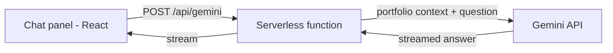
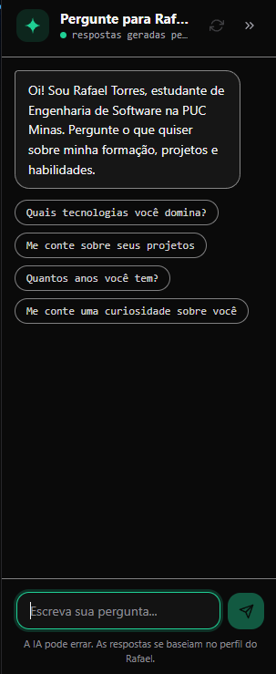
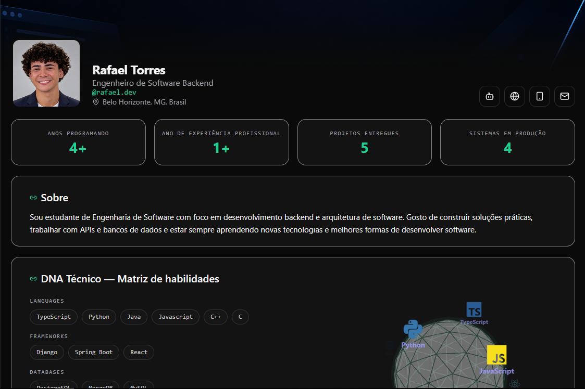
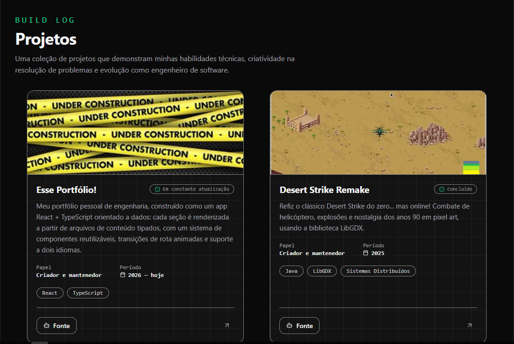
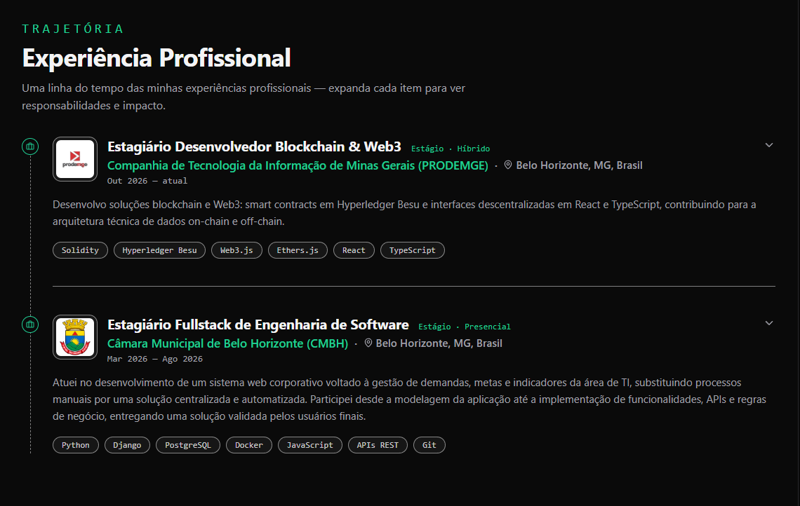
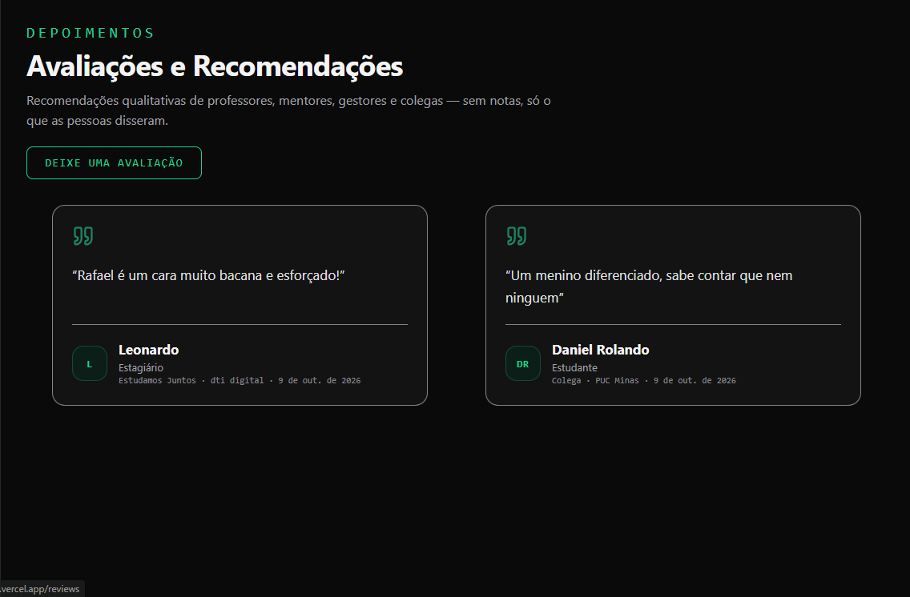
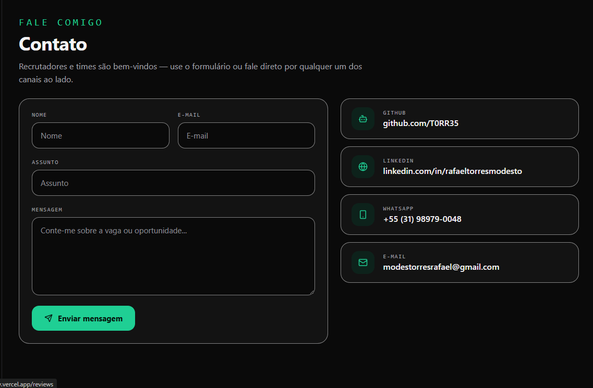

# 💻 Professional Portfolio

> A professional portfolio inspired by social media platforms, where visitors can explore my profile, projects, professional experience, recommendations, and contact information — and ask an AI assistant about me.


🚧 **Status:** Under constant development.

---

## 📚 Table of Contents

- [Useful Links](#-useful-links)
- [About the Project](#-about-the-project)
- [How to Navigate](#-how-to-navigate)
- [Main Features](#-main-features)
- [AI Assistant](#-ai-assistant)
- [Technologies](#-technologies)
- [Architecture](#-architecture)
- [Installation and Setup](#-installation-and-setup)
- [Environment Variables](#-environment-variables)
- [Project Structure](#-project-structure)
- [Deployment](#-deployment)
- [Screenshots](#-screenshots)
- [Roadmap](#-roadmap)
- [Documentation](#-documentation)
- [Author](#-author)
- [License](#-license)

---

## 🔗 Useful Links

- 🌐 **Live Demo:** [See it live](https://my-portfolio-alpha-one-l05ufsvlnv.vercel.app/)
- 📦 **Repository:** [GitHub Repository](https://github.com/T0RR35/MyPortfolio)
- 💼 **LinkedIn:** [My LinkedIn Profile](https://linkedin.com/in/rafaeltorresmodesto/)

---

## 📝 About the Project

This project is my personal professional portfolio, designed to present my background, technical skills, projects, and professional experience in an interactive and organized way.

Instead of following the structure of a traditional portfolio website, the interface is inspired by **social media platforms**. Visitors can explore my profile, learn about my projects and experience, read and leave recommendations, and find ways to contact me.

The application is designed to give recruiters, developers, and other visitors a straightforward way to learn about my professional journey and technical interests. Anyone who prefers to ask instead of browsing can use the built-in **AI assistant**, which answers questions about me in the first person.

The project also includes a bilingual interface (English and Portuguese) and a dark/light theme switcher, providing a more flexible browsing experience.

---

## 🧭 How to Navigate

The website is organized into sections accessible through the navigation sidebar (on mobile, the sidebar becomes a bottom navigation bar).

| Section | Description |
| :--- | :--- |
| **Home** | Main feed with my posts and updates *(coming soon)*. |
| **Profile** | Presents my background, education, certifications, languages, and an interactive 3D skill globe. |
| **Projects** | Showcases selected projects, their descriptions, stacks, and repositories. Hover a card to preview the project in action. |
| **Experience** | A timeline of my professional experience, with expandable responsibilities and achievements. |
| **Reviews** | Displays recommendations and testimonials, and lets visitors leave their own. |
| **Contact** | A contact form and direct links to my channels. |
| **Chat panel** | A side panel available on every page, where visitors can ask the AI assistant about me. It can be minimized. |

Visitors can also switch between **English and Portuguese** and between **dark and light themes**. Unknown URLs lead to a custom 404 page.

---

## ✨ Main Features

- 🏠 **Social Media-Inspired Layout:** Sidebar navigation and a feed-oriented structure.
- 👤 **Professional Profile:** Background, education, certifications, spoken languages, and an interactive 3D skill globe.
- 💻 **Projects Showcase:** Cards with a cover image that turns into a GIF preview on hover, plus status, role, period, and tech stack.
- 💼 **Professional Experience:** An expandable timeline with responsibilities, achievements, and technologies.
- 💬 **Recommendations:** Testimonials loaded from a database, with a submission form protected by validation and anti-spam measures.
- 📩 **Contact Form:** Messages delivered straight to my inbox through EmailJS, with a honeypot field against bots.
- 🤖 **AI Assistant:** A streaming chat grounded in my portfolio data (see [AI Assistant](#-ai-assistant)).
- 🌐 **Bilingual Interface:** English and Portuguese, switchable at any time without reloading.
- 🌓 **Dark and Light Themes:** A theme switcher that remembers the visitor's choice.
- 🎞️ **Animated Page Transitions:** Smooth route changes powered by Framer Motion.
- 📱 **Responsive Design:** The sidebar becomes a bottom bar on mobile, and the chat panel becomes a floating layer on smaller screens.
- ♿ **Accessibility:** Semantic HTML, keyboard navigation, visible focus states, ARIA labels, and support for `prefers-reduced-motion`.
- 🧩 **Reusable Components:** A modular structure to improve maintainability and consistency.

---

## 🤖 AI Assistant

The portfolio includes a chat assistant that answers questions about me (stack, projects, experience, education, and so on) **in the first person**, in the language of the question.



**How it works**

- The chat panel sends the conversation to a serverless function (`api/gemini.js`).
- The function builds a context from my portfolio data and calls the Gemini API with a system prompt that tells the model to answer **only** from that context.
- Answers are streamed back word by word and rendered as simple, safe Markdown (no `innerHTML`, so nothing coming from the AI is turned into real HTML).

**Safeguards**

- The Gemini API key lives **only on the server**. It is never exposed to the browser.
- The model is instructed not to invent dates, companies, grades, or numbers, to refuse off-topic requests, and to point visitors to my email when it doesn't know something.
- The interface warns visitors that the AI can make mistakes.
- Rate-limit and API errors are handled and shown with a helpful message.

---

## 🛠️ Technologies

### 💻 Front-end

- **Library:** [React](https://react.dev/)
- **Language:** [TypeScript](https://www.typescriptlang.org/)
- **Build Tool:** [Vite](https://vite.dev/)
- **Routing:** [React Router](https://reactrouter.com/)
- **Animation:** [Framer Motion](https://www.framer.com/motion/)
- **3D:** [Three.js](https://threejs.org/), [React Three Fiber](https://r3f.docs.pmnd.rs/) and [Drei](https://drei.docs.pmnd.rs/) (skill globe)
- **Theming:** [next-themes](https://github.com/pacocoursey/next-themes)
- **Styling:** Plain CSS with design tokens (CSS variables)
- **Icons:** [Lucide React](https://lucide.dev/) and [React Icons](https://react-icons.github.io/react-icons/)

### 🗄️ Data and Services

The application organizes portfolio content into dedicated data and service modules.

- **Data Modules:** Manage the structured, typed, bilingual content displayed throughout the website.
- **Services:** Separate external service communication from the presentation layer.
- **[Supabase](https://supabase.com/):** Stores and serves the reviews (testimonials).
- **[EmailJS](https://www.emailjs.com/):** Delivers the contact form messages.
- **[Gemini API](https://ai.google.dev/):** Powers the AI assistant, called only from a serverless function.

### ⚙️ Development and Deployment Tools

- **Hosting:** [Vercel](https://vercel.com/) (static site + serverless function)
- **Version Control:** [Git](https://git-scm.com/)
- **Repository Hosting:** [GitHub](https://github.com/)
- **Package Manager:** npm
- **Code Editor:** [Visual Studio Code](https://code.visualstudio.com/)
- **Prototypes:** [Figma](https://www.figma.com/)

---

## 🧱 Architecture

### Overview

The application is a **Single Page Application (SPA)** built with React, TypeScript, and Vite, plus **one serverless function** that talks to the Gemini API.

Its structure separates pages, reusable components, data, services, and styling to make the codebase easier to understand and maintain.

### Main Components

- **src/pages:** Represent the main sections of the portfolio: Home, Profile, Projects, Experience, Reviews, Contact, and the 404 page.
- **src/components:** Reusable interface elements shared across sections (layout, sidebar, cards, chat panel, forms, and so on).
- **src/data:** Structured, typed content, with one version per language and a hook for each domain (`useProfile`, `useProjects`, `useExperience`, ...).
- **src/services:** Communication with external services (Supabase, Gemini).
- **src/config:** Configuration for the AI assistant (name, welcome message, suggestions, limits).
- **src/types:** TypeScript types shared across the application.
- **src/utils:** Small helpers, such as the language store and date formatting.
- **api:** The serverless function for the AI assistant and the portfolio context it uses.
- **public:** Images, GIFs, and other static resources.

### Architectural Decisions

- **No dedicated back-end server:** Database storage and email delivery come from managed services (Supabase and EmailJS). The only server-side code is a single serverless function, which exists so the Gemini API key never reaches the browser.
- **Static content stored in the codebase:** Projects, experience, and profile data change infrequently, so they remain version-controlled instead of being stored in a database.
- **Lightweight language switching:** There is no i18n library. A small external store (consumed with React's `useSyncExternalStore`) holds the current language, and every data hook returns the matching version, so the whole page updates instantly.
- **Database-level 'Reviews' security:** Access rules (RLS) and input length restrictions are enforced directly by Supabase, rather than relying solely on browser-side validation. Since the public Supabase key is necessarily exposed in the client, security depends on properly configured database policies.
- **Public keys on the front end:** Only public `VITE_*` environment variables are used in the client-side application. Secret keys — such as the Gemini API key, the Supabase `service_role` key, and the private EmailJS key — are never included in the client bundle.
- **Grounded AI answers:** The assistant receives only my portfolio data as context and is instructed to answer from it, reducing made-up answers.
- **Plain CSS with design tokens:** Colors, spacing, and typography come from CSS variables, which makes light/dark themes straightforward. Class names are prefixed per component to avoid collisions.
- **Accessibility by default:** Components are built with semantic elements, keyboard support, and reduced-motion fallbacks from the start.

### Trade-offs

- **Deployment required for content updates:** Updating a project or professional experience requires a new deployment.
- **Manual 'reviews' moderation:** Inappropriate messages must be deleted through the Supabase dashboard. Submission cooldowns and a honeypot field discourage casual abuse, but direct API requests can bypass these client-side measures.
- **Duplicated translated content:** Content is stored separately for each supported language, increasing duplication but ensuring that both translations are explicitly defined.
- **Duplicated data for the AI:** The serverless function can't use React hooks, so the portfolio context in `api/` is a separate copy of the data in `src/data`. Both need to be updated together.
- **Free-tier limits:** The Gemini API and EmailJS have usage limits on their free plans, so the assistant may occasionally ask visitors to try again later.
- **AI can be wrong:** Answers are generated by a language model, so they may occasionally be inaccurate even with a grounded context.

---

## 🔧 Installation and Setup

### Prerequisites

Make sure you have the following installed:

- [Node.js](https://nodejs.org/)
- npm
- [Git](https://git-scm.com/)

You will also need accounts (all have free plans) for [Supabase](https://supabase.com/), [EmailJS](https://www.emailjs.com/), and [Google AI Studio](https://aistudio.google.com/apikey) if you want every feature to work locally.

### 📦 Installation

Clone the repository:

```bash
git clone https://github.com/T0RR35/MyPortfolio.git
cd MyPortfolio
```

Install the dependencies:

```bash
npm install
```

Create your local environment file (see [Environment Variables](#-environment-variables)):

```bash
cp .env.example .env.local
```

### ⚡ Running the Application

Start the development server:

```bash
npm run dev
```

Vite will display a local URL in the terminal. Open that URL in your browser to explore the application. During development, the `api/` function is served by the same dev server, so the AI assistant works locally too.

### 📜 Available Scripts

| Command | Description |
| :--- | :--- |
| `npm run dev` | Starts the development server. |
| `npm run build` | Builds the application for production. |
| `npm run preview` | Runs a local preview of the production build. |

Additional scripts may be available depending on the project's `package.json`.

---

## 🔐 Environment Variables

Create a `.env.local` file in the project root (it is ignored by Git). Use `.env.example` as a template.

| Variable | Used by | Description |
| :--- | :--- | :--- |
| `VITE_EMAILJS_SERVICE_ID` | Browser | EmailJS service ID. |
| `VITE_EMAILJS_TEMPLATE_ID` | Browser | EmailJS template ID. |
| `VITE_EMAILJS_PUBLIC_KEY` | Browser | EmailJS public key. |
| `VITE_SUPABASE_URL` | Browser | Supabase project URL. |
| `VITE_SUPABASE_ANON_KEY` | Browser | Supabase public (anon) key. |
| `GEMINI_API_KEY` | **Server only** | Gemini API key. |
| `GEMINI_MODEL` | **Server only** | *(Optional)* Gemini model name. |

> ⚠️ Only variables starting with `VITE_` are exposed to the browser. **Never** add the `VITE_` prefix to a secret such as `GEMINI_API_KEY`, and never commit your `.env.local` file.

Restart `npm run dev` after changing any variable.

---

## 📂 Project Structure

The following structure illustrates the main organization of the application.

```text
portfolio/
├── api/                     # Serverless function for the AI assistant
│   ├── gemini.js            # Endpoint (POST /api/gemini)
│   ├── _gemini.js           # Gemini call, system prompt, streaming
│   └── _profile.js          # Portfolio context sent to the model
├── public/                  # Public static assets (images, GIFs, logo)
├── src/
│   ├── components/          # Reusable UI components
│   ├── config/              # AI assistant configuration
│   ├── data/                # Structured, bilingual portfolio content
│   ├── pages/               # Main application pages
│   ├── services/            # External service integrations
│   ├── types/               # Data types
│   ├── utils/               # Language store, formatters, and other helpers
│   ├── App.tsx              # Routes and providers
│   └── main.tsx             # Application entry point
├── .env.example             # Environment variables template
├── index.html               # HTML entry point
├── package.json             # Dependencies and scripts
├── tsconfig.json            # TypeScript configuration
├── vite.config.ts           # Vite configuration (includes the dev server for api/)
└── README.md                # Project documentation
```

> Files starting with `_` inside `api/` are helpers: Vercel does not treat them as separate endpoints.

---

## 🚀 Deployment

The site is deployed on [Vercel](https://vercel.com/):

1. Import the repository in Vercel (the Vite preset is detected automatically).
2. In **Project Settings → Environment Variables**, add every variable from the table above.
3. Deploy. The static site is built from `src/`, and the files in `api/` become serverless functions.

**Direct links returning 404?** Because the app uses client-side routing, refreshing on a route such as `/profile` needs a fallback to `index.html`. Add a `vercel.json` like this, which leaves the `/api` routes untouched:

```json
{
  "rewrites": [{ "source": "/((?!api/).*)", "destination": "/index.html" }]
}
```

**Recommended hardening:** in the EmailJS dashboard, restrict the allowed domains to your site, and keep the Supabase RLS policies enabled.

---

## 🎨 Screenshots

Screenshots of the application will be added here as development progresses.


| Agent | Profile |
| :---: | :---: |
|  |  |

| Projects | Experience |
| :---: | :---: |
|  |  |

| Reviews | Contact |
| :---: | :---: |
|  |  |


---

## 📌 Roadmap

- [ ] Redesign the Experience page to make it less cluttered.
- [ ] Implement notification pop-ups.
- [ ] Add LinkedIn and GitHub authentication to allow users to leave testimonials.
- [ ] Add an accessibility button.
- [ ] Make each project clickable and open its own dedicated page.
- [ ] Create a banner for each project, indicating its category (academic, professional, etc.).
- [ ] Integrate WakaTime and GitHub stats into the profile.
- [ ] Improve the layout and responsiveness for mobile devices.
- [ ] Adjust the background image to match the light theme.
- [ ] Clean up the browser console (F12) by resolving warnings and errors.
- [ ] Standardize page headers across all pages.

---

## 📖 Documentation

- [React Documentation](https://react.dev/)
- [TypeScript Documentation](https://www.typescriptlang.org/docs/)
- [Vite Documentation](https://vite.dev/guide/)
- [React Router Documentation](https://reactrouter.com/)
- [Framer Motion Documentation](https://www.framer.com/motion/)
- [React Three Fiber Documentation](https://r3f.docs.pmnd.rs/)
- [Lucide React Documentation](https://lucide.dev/guide/packages/lucide-react)
- [Supabase Documentation](https://supabase.com/docs)
- [EmailJS Documentation](https://www.emailjs.com/docs/)
- [Gemini API Documentation](https://ai.google.dev/gemini-api/docs)
- [Vercel Documentation](https://vercel.com/docs)
- [MDN Web Docs — CSS](https://developer.mozilla.org/en-US/docs/Web/CSS)
- [Git Documentation](https://git-scm.com/doc)

---

## 👤 Author

**Rafael Torres**

- **GitHub:** [T0RR35](https://github.com/T0RR35)
- **LinkedIn:** [My LinkedIn Profile](https://linkedin.com/in/rafaeltorresmodesto/)

Software Engineering student at PUC Minas, interested in software development, particularly back-end development and client-server applications.

---

## 📄 License

The licensing terms for this project have not yet been specified.